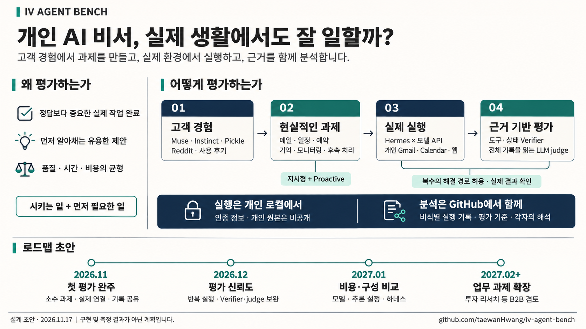
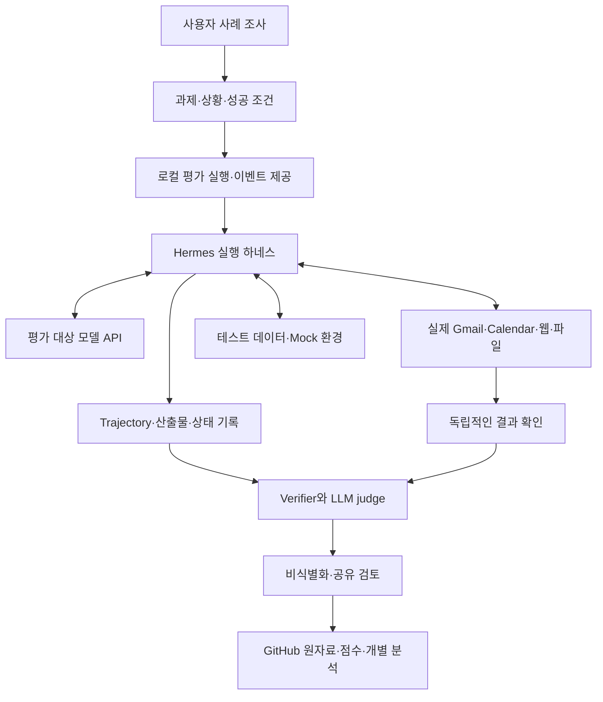

# IV Agent Bench

개인형 AI 에이전트가 실제 생활에서 얼마나 유용하게 일하는지 평가하고, 그 실행 근거를 함께 분석하기 위한 프로젝트입니다.

> 작성일: 2026-11-17. 현재 상태는 로컬 평가 기록·채점 도구 v0.1이며 첫 실제 고정 스냅샷 비교를 완료했습니다. 실시간 서비스 도구형 평가와 suite 자동 실행은 아직 미완료입니다. 월별 계획은 실험 결과에 따라 조정합니다.

## Executive Summary



[원본 이미지 보기](docs/assets/iv-agent-bench-executive-summary.png)

## 개발 시작: 로컬 v0.1

[실험 목록·버전 관리](experiments/README.md) · [첫 실험 b2c-v0.1.0](experiments/b2c-v0.1.0/README.md) · [로컬 실행 절차](docs/local-workflow.md) · [구현 현황과 다음 단계](docs/implementation-status.md) · [과제 후보의 출처](research/scenario-candidates.md)

```zsh
python3 scripts/validate_experiments.py
python3 -m unittest discover -s tests -v
python3 -m iv_agent_bench demo
```

Python 3.9 이상에서 추가 의존성 없이 동작합니다. Demo는 합성 데이터로 기록·검증·judge 자료 생성만 확인하며, 모델 성능 결과가 아닙니다. 현재 CLI는 Hermes를 자동 실행하거나 개인 계정에 연결하지 않습니다. 실제 실행 후 지정 세션을 읽기 전용으로 가져와 독립 관찰과 수동 LLM 평가를 연결합니다. 개인 원본은 Git에서 제외되는 `.private/`에 보관합니다.

## 왜 만드는가

모델 벤치마크 점수만으로는 개인 비서의 유용성을 판단하기 어렵습니다. 사용자는 정확한 답변뿐 아니라 메일 처리, 일정 조율, 후속 작업 완료, 개인 선호의 기억, 필요한 순간의 선제적 제안을 기대합니다. 반대로 불필요한 알림이나 승인 없는 행동은 신뢰를 훼손합니다.

기존 Hermes 기반 Solar·EXAONE·GPT 비교는 출발점이었습니다. 다만 모델, 도구, 서비스 오류, 시간 한도와 평가 기준의 영향이 섞여 있었습니다. 이 프로젝트는 그 경험을 바탕으로 실행 조건과 판정 근거를 기록하고, 다른 투자 심사역도 자신의 관점에서 원자료를 재분석할 수 있게 합니다.

핵심 질문은 다음과 같습니다.

- 어떤 모델과 에이전트 구성이 어떤 생활 업무를 실제로 완료하는가?
- 요청하지 않은 문제를 발견하고 유용하게 제안하는가? 개입하지 않아야 할 때는 멈추는가?
- 품질을 유지하면서 완료 시간, 비용, 모델 호출과 사용자 개입을 줄일 수 있는가?
- 실패 원인이 모델 판단, 하네스, 도구, API 제공사 중 어디에 있는가?

## 운영 범위

초기 실행자는 태완 한 명입니다. 로컬에서 Codex와 대화하며 평가를 준비·실행·분석하고, 필요하면 본인의 Gmail·Calendar 등 실제 서비스를 연결합니다. 계정 연결 의향은 모든 발송·변경에 대한 포괄적 승인을 뜻하지 않으며, 과제별로 허용 행동을 정합니다.

GitHub는 평가 체계, 코드, 공유 가능한 실행 기록과 분석을 보관합니다. 동료는 원자료를 재분석하고 과제·채점 개선을 제안할 수 있습니다. 개인 계정을 사용하는 동일 환경의 재실행은 초기 목표가 아닙니다. GitHub Actions, 공개 순위 서비스, 누구나 실행하는 플랫폼도 초기 범위에서 제외합니다.

## 설계



### Hermes와 평가 체계의 관계

Hermes를 첫 실행 하네스로 활용합니다. 대화, 도구 사용, 기억과 작업 반복은 Hermes가 담당하고, 이 저장소는 과제·환경 준비·기록·채점을 관리합니다. 평가 자산은 가능한 한 Hermes 외부에 두어 이후 다른 하네스에도 연결할 수 있게 합니다.

초기 결과는 “해당 Hermes 설정에서 측정한 모델 성능”입니다. 모델 자체의 보편적 순위로 해석하지 않습니다. Codex는 실험을 돕는 역할이며, 평가 도중 답이나 코드를 수정해주면 개입으로 기록합니다.

### 고객 경험에서 과제를 만든다

Muse·Instinct·Pickle 등의 실제 사용 경험을 Reddit, 사용자 블로그, 앱스토어, 직접 사용 리뷰 등에서 조사합니다. 공식 설명, 직접 경험, 간접 인용, 추천 코드가 있는 게시물, 중복 게시물을 구분합니다. 후기 수를 사용 빈도나 대표성으로 단정하지 않습니다.

각 과제에는 출처, 사용자의 목적, 유용했던 점과 불만, 평가 상황으로 변환한 이유를 연결합니다. 기존 Q1~Q4는 역사적 파일럿으로 보존하며 새 기준의 점수와 바로 합산하지 않습니다.

후보 영역은 메일·일정, 예약과 고객센터, 구매·가격 모니터링, 개인화된 정보 정리, 기억과 후속 처리입니다. 선정은 추가 조사 후 확정합니다.

Proactive 평가는 위임받은 모니터링과 맥락에서 스스로 발견하는 제안을 구분합니다. 유용한 개입뿐 아니라 잘못된 알림, 반복 알림, 불필요한 개입, 선호 변경 후 중단 여부를 평가합니다. 관찰 시점과 이벤트를 고정하는 판단 평가, 실제 백그라운드 동작을 확인하는 운영 평가를 구분합니다.

### 실제 환경과 통제된 환경을 함께 사용한다

- 실제 개인 환경: 현실적인 맥락과 서비스 제약을 관찰합니다. 읽기·제안, 초안, 승인된 실행을 단계적으로 확대합니다.
- 실제 서비스의 테스트 데이터: 평가용 메일·일정 등으로 실제 API와 브라우저 동작을 확인합니다.
- 고정 스냅샷·Mock: 동일 입력 비교, 경계 조건, 오류 주입과 빠른 반복에 사용합니다.

실제 Gmail API 도구와 브라우저 조작은 서로 다른 조건입니다. 도구 범위, 권한, 초기 상태, 시각·시간대, 사용 가능한 기억을 실행마다 기록합니다. 먼저 실행한 모델이 환경을 바꾸지 않도록 상태 복원·분리 또는 읽기 전용 비교를 사용합니다. 통제가 어려운 실제 실행은 관찰 평가로 명시합니다.

### Verifier와 LLM judge

Verifier는 문자열 일치나 하나의 정답 호출 순서보다 최종 상태, 도구 인자·결과, 승인과 행동의 선후 관계, 금지 행동을 확인합니다. 동일 목표에 도달하는 여러 경로를 인정합니다. 도구 호출 자체를 성공으로 간주하지 않습니다.

LLM judge는 최종 답변만이 아니라 전체 trajectory와 verifier 결과를 읽고, 제안의 유용성·시의성, 선호 반영, 한국어, 불필요한 질문과 왕복, 상태 보고의 정직성을 평가합니다. 모델 이름은 가리고 judge·프롬프트 버전과 근거 이벤트를 남깁니다. 직접 확인한 상태 불일치를 주관적 호평으로 상쇄하지 않습니다.

여러 모델의 시범 실행으로 verifier의 오탐과 누락도 점검합니다. 유효한 다른 경로와 의도적으로 잘못된 실행을 모두 시험합니다. 기준 변경은 새 버전으로 기록하고 같은 원자료에 재적용합니다. 필요한 정보가 없으면 판단 불가로 남기며 근거 없이 실패나 성공으로 확정하지 않습니다.

## 기록과 공유

각 실행에는 실행 ID, 과제·하네스·검증기 버전, 코드 커밋, 모델·제공사·요청 및 확인 가능한 적용 설정, 도구·권한, 초기 상태, 입력·응답·도구 기록, 산출물, 시간·비용·토큰·재시도와 개입을 남깁니다. 공개되지 않은 내부 추론을 확보했다고 전제하지 않습니다.

원자료, 채점, 작성자별 해석은 분리합니다. 재분석은 같은 기록을 새 관점으로 읽는 일, 재채점은 새 기준을 적용하는 일, 재실행은 새 모델 호출을 만드는 일입니다. 이전 기록을 덮어쓰지 않습니다.

원본 trajectory·메일·일정·인증 정보는 로컬 비공개 영역에 보관합니다. 공유본은 비식별화하고 필요한 맥락을 보존합니다. 기록마다 공유 자료만으로 판정 검토 가능 / 일부 비공개로 제한 / 요약만 제공 중 하나를 표시합니다. 민감한 내용은 외부 judge로 전송하기 전에도 범위를 검토합니다.

### 지표

| 축 | 기록할 지표 |
|---|---|
| 품질 | 완료·부분 충족·실패, 영역별 결과, proactive 제안의 적절성, 권한 위반 |
| 시간 | 완료 시간, 시간 초과, 사용자 대기와 실제 경과 시간 |
| 효율 | 모델별 호출, 비용, 재시도, 사용자 개입, 성공 1건당 비용 |
| 원인 | 과제 실패, 제공사 오류, 하네스 오류, 사용자 중단 |

성공당 비용에는 실패 시도의 비용도 포함하며 성공이 없으면 N/A입니다. 시간 초과는 운영상 실패로 집계하되 원인을 구분합니다. 반복 횟수와 조건 차이를 표시하고, 초기에는 임의의 종합 순위 하나로 축약하지 않습니다.

## 디렉터리

현재 과제·CLI·검증기·문서가 생성되었습니다. 실험별 검토된 요약은 experiments/에서 버전으로 관리합니다. runs/와 analyses/는 필요 시 추가합니다.

```text
AGENTS.md          # Codex 실행·분석 지침
.env.example       # 비밀값 없는 설정 예시
research/          # 출처 목록과 시나리오 선정 근거
tasks/             # 과제·데이터·허용 행동·판정 기준
iv_agent_bench/    # 로컬 CLI·Hermes import·상태 verifier·judge 연결
tests/             # 합성 데이터 기반 검증
experiments/       # 실험 버전별 목적·coverage·집계·공유 범위
scripts/           # 실험 레지스트리 정합성 검사
runs/              # 검토된 공유본·설정·점수
analyses/          # 작성자별 분석
```

비공개 원자료는 Git 추적 대상 밖에 둡니다. 현재 실행 지침은 [로컬 평가 절차](docs/local-workflow.md)에 있습니다.

## 로드맵 초안

### 2026년 11월 — 작은 평가를 처음부터 끝까지 실행

목표는 평가 플랫폼 완성이 아니라, 근거 있는 소수 과제를 실제 환경에서 실행하고 공유하는 첫 버전입니다.

- [ ] 목적·설계·범위와 로드맵 문서 확정
- [ ] 사용자 사례 조사와 출처·중복·이해관계 표시
- [ ] 지시형·proactive를 포함한 6~8개 시나리오 후보 및 성공 조건 작성
- [ ] Hermes 연결과 로컬 기록 형식의 최소 구현
- [ ] Gmail·Calendar 연결 범위 결정 및 허용된 소수 과제 실행
- [ ] 상태·도구 verifier 및 trajectory 기반 judge 시범 적용
- [ ] 최소 2개 모델 설정으로 일부 과제를 비교하고 verifier 오탐 검토
- [ ] 비식별화한 실행 기록과 첫 비교 보고서 공유

완료 기준: 동료가 태완의 설명 없이 README와 공유 기록을 읽고, 판정 근거를 확인해 다른 분석이나 개선안을 작성할 수 있습니다. 모든 후보 과제의 구현·대규모 반복·자율 발송은 11월 필수 요건이 아닙니다.

### 2026년 12월 — 평가 신뢰도와 실제 사용 범위 확대

실행 가능한 과제를 12~16개 수준으로 확장하는 것을 잠정 목표로 합니다. 반복 실행, 상태 초기화, 유효한 대체 경로, judge의 사람 판정 일치도를 점검합니다. 여러 날에 걸친 proactive 후속 처리와 알림 억제를 평가하고 동료의 재분석 의견을 반영합니다.

### 2027년 1월 — 비용·품질과 실행 구성 비교

모델·추론 설정·주/보조 모델 구성의 품질·지연·성공당 비용을 비교합니다. API 도구와 브라우저 환경을 구분해 평가하고, 동일 문제를 다른 하네스에 연결하는 소규모 검증을 검토합니다.

### 2027년 2월 — 투자 업무 과제로 확장 검토

개인 비서 평가의 안정성을 확인한 뒤 기업 조사·자료 대조·미팅 준비 등 B2B 과제를 별도 suite로 검토합니다. 민감 자료의 범위를 정하고 사실 검증·출처·누락을 중심으로 평가합니다. B2C와 B2B 점수는 분리합니다.

### 2027년 3월 이후 — 축적된 실패를 평가 자산으로 전환

월별 새 모델·구성을 같은 버전의 과제로 재평가하고 실제 사용 실패를 회귀 과제로 추가합니다. 데이터·채점 변경 이력과 과거 결과의 비교 가능성을 관리합니다. 다중 실행자·자동화·대시보드는 실제 수요가 생길 때 결정합니다.

## 초기 조사 참고 자료

아래는 시나리오 발굴용 자료이며 제품 성능이나 고객 대표성을 입증하지 않습니다. 추천 링크가 포함된 후기도 있어 추가 교차 확인이 필요합니다.

- [Muse: 메일 정리·약속 조율 등 Reddit 후기](https://www.reddit.com/r/MetaAI/comments/1xij6yh/a_week_with_muse_as_my_actual_personal_assistant/)
- [Muse: 실패·사용자 개입 경험 토론](https://www.reddit.com/r/AI_Agents/comments/1xi0gds/for_anyone_whos_used_metas_muse_agent_where_did/)
- [Instinct: 직접 사용 경험과 승인 문제](https://www.androidauthority.com/using-ai-agent-instinct-one-month-later-impressions-3720825/)
- [Pickle: 전화·정보 정리 사용자 후기](https://note.com/matomechannel/n/nc9b460253ceb)
- [Muse: 메일·일정 맥락과 선제적 도움 사용기](https://www.techradar.com/ai-platforms-assistants/i-gave-muse-access-to-my-personal-data-and-now-i-know-why-personal-agents-are-probably-going-to-change-the-world)

## 기여

새로운 사용 사례, 실패 근거, verifier의 오탐·누락, judge에 대한 이견, 독립적인 분석을 환영합니다. 과제나 채점을 바꾸는 제안에는 이유와 영향을 명시합니다. 개인 계정 접근이나 비공개 원자료 제공은 기여의 전제 조건이 아닙니다.
